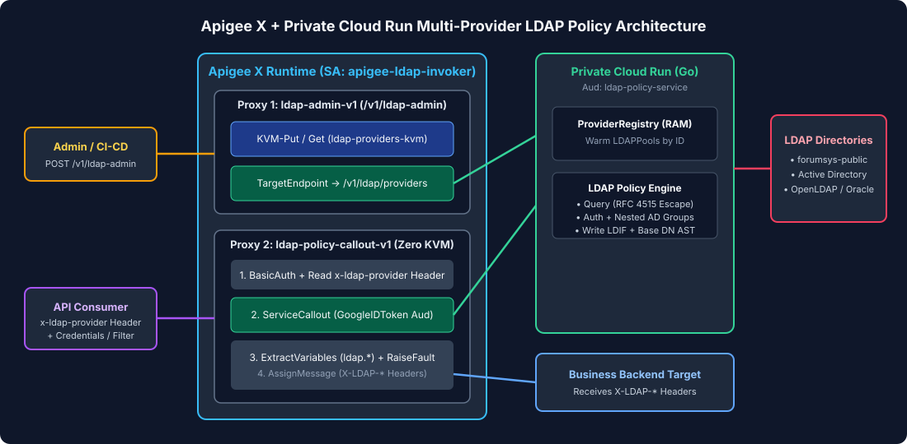
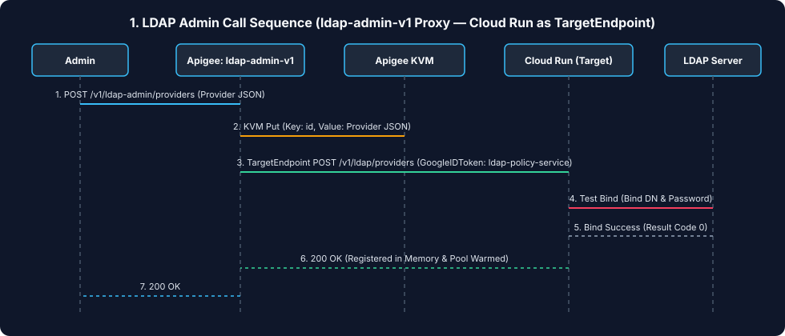
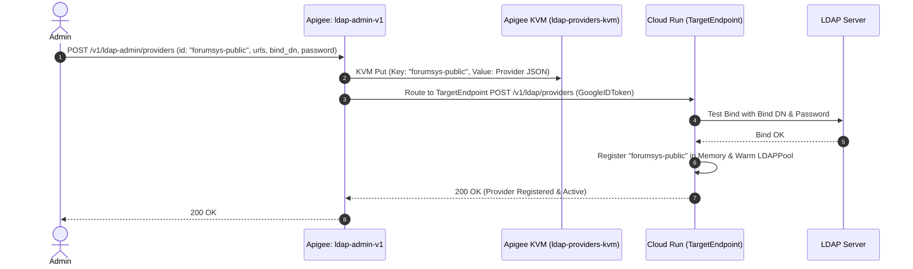
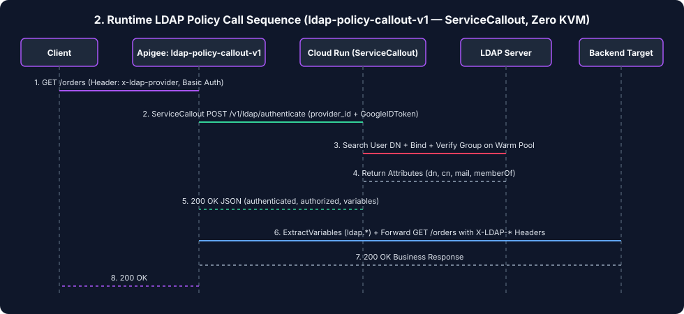
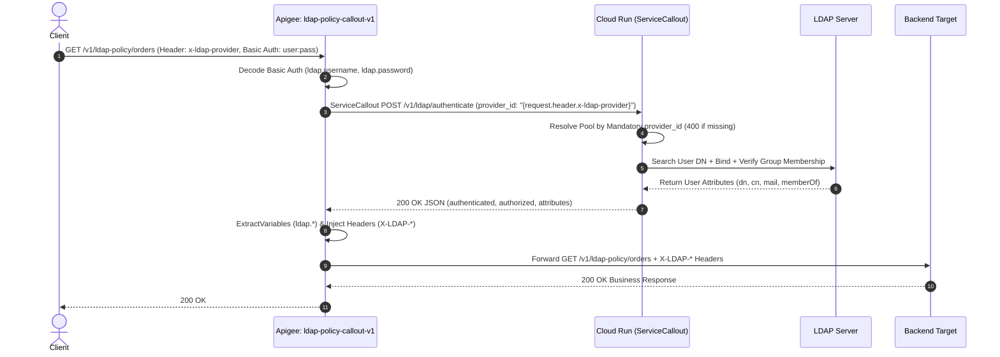

# Apigee X + Private Cloud Run Multi-Provider LDAP Policy Emulator

[](https://colab.research.google.com/github/luiscuellarh/apigee-cloudrun-ldap-policy/blob/main/colab/deploy_cloudrun_apigee.ipynb)

Production-grade reference architecture and automated deployment toolkit that brings **enterprise LDAP Policy operations** (*Query LDAP*, *Write LDAP*, and *Authenticate & Authorize User or Group*) and **legacy Apigee Edge `<Ldap>` policy** capabilities to **Apigee X**, powered by an ultra-low-latency **Go (`go-ldap/v3`) Cloud Run microservice** secured with **IAM and Custom OIDC Audiences**.

---

## 1. Repository Structure

```text
apigee-cloudrun-ldap-policy/
├── README.md                                  # Architecture, security, and step-by-step deployment guide
├── deploy.sh                                  # Master end-to-end deployment orchestrator
├── test.sh                                    # End-to-end curl verification suite (9 test scenarios)
├── colab/
│   └── deploy_cloudrun_apigee.ipynb           # Interactive Google Colab / Colab Enterprise One-Click UI
├── docs/
│   └── images/
│       ├── architecture-overview.svg          # High-level system architecture diagram
│       ├── admin-flow-sequence.svg            # Sequence diagram: Admin Proxy (KVM + TargetEndpoint)
│       └── runtime-flow-sequence.svg          # Sequence diagram: Runtime Proxy (ServiceCallout)
├── src/
│   ├── Dockerfile                             # Multi-stage Go 1.22 -> distroless/static (~12 MB image)
│   ├── go.mod                                 # Go module (github.com/go-ldap/ldap/v3)
│   ├── main.go                                # HTTP handlers (/query, /write, /authenticate, /providers)
│   ├── pool.go                                # Thread-safe ProviderRegistry & warm LDAPS connection pools
│   ├── operations.go                          # RFC 4515/4514 escaping, Write Base DN AST guard, LDIF parser
│   ├── mock_directory.go                      # Built-in directory provider for zero-dependency testing
│   └── providers.json                         # Bootstrap provider configuration
├── apigee/
│   ├── ldap-admin-proxy.template.yaml         # Apigee Templater (AFT) YAML for ldap-admin-v1
│   └── ldap-policy-proxy.template.yaml        # Apigee Templater (AFT) YAML for ldap-policy-callout-v1
└── scripts/
    ├── 00-env.sh                              # Shared variables, CLI flags & dynamic Apigee API discovery
    ├── 01-setup-gcp.sh                        # Zero-to-One GCP APIs, Runtime SA, Invoker SA & IAM bindings
    ├── 02-deploy-cloudrun.sh                  # Private Cloud Run deployment + Custom Audience + run.invoker
    └── 03-deploy-apigee.sh                    # Encrypted KVM creation + AFT deployment of both proxies
```

---

## 2. Architecture Overview



### Two-Proxy Separation of Concerns

1. **LDAP Admin Proxy (`ldap-admin-v1` at `/v1/ldap-admin` — Uses Apigee KVM + Cloud Run as `TargetEndpoint`):**
   - Persists LDAP Identity Provider configurations (`id`, `profile`, `urls`, `base_dn`, `write_base_dn`, `bind_dn`, `bind_password`) inside an **encrypted Apigee Environment KVM (`ldap-providers-kvm`)**.
   - Routes directly to the private Cloud Run service as its **`TargetEndpoint`** (`POST /v1/ldap/providers`) authenticated via `<GoogleIDToken><Audience>ldap-policy-service</Audience></GoogleIDToken>`.
   - Cloud Run validates the LDAP schema, tests the bind against the target LDAP server, and registers a warm `LDAPPool` in memory—requiring **zero Cloud Run redeployments** to onboard new LDAP servers.

2. **Runtime LDAP Policy Proxy (`ldap-policy-callout-v1` at `/v1/ldap-policy` — Zero KVM, Cloud Run as `ServiceCallout`):**
   - Emulates the native LDAP Policy inside the proxy `PreFlow` using a synchronous **`ServiceCallout`** (`SC-LDAP-Policy-*`) with **zero KVM lookup on the runtime path**.
   - Enforces strict multi-tenant isolation: **no global default provider**. Every policy call passes its mandatory `"provider_id"` (via the `x-ldap-provider` request header or policy configuration).
   - Extracts returned LDAP attributes into standard Apigee flow variables (`ldap.dn`, `ldap.cn`, `ldap.mail`, `ldap.displayName`, `ldap.department`, `ldap.telephoneNumber`, `ldap.memberOf`) and injects upstream `X-LDAP-*` headers before forwarding to the business backend target.

---

## 3. Sequence Flow Diagrams

### Flow 1: Onboarding an LDAP Server (`ldap-admin-v1` — KVM + Cloud Run `TargetEndpoint`)





### Flow 2: Runtime LDAP Policy Call (`ldap-policy-callout-v1` — `x-ldap-provider` Header + `ServiceCallout`)





---

## 4. How Cloud Run Custom Audiences Work with Apigee `<GoogleIDToken>`

By default, a private Cloud Run service (`--no-allow-unauthenticated`) only accepts Google-signed OIDC ID tokens whose `aud` (Audience) claim exactly matches the auto-generated `https://<service>-<hash>.a.run.app` URL.

Configuring **`--custom-audiences="ldap-policy-service"`** on Cloud Run decouples the security contract from ephemeral infrastructure URLs:
1. **In Apigee X (`ServiceCallout` / `TargetEndpoint`):**
   When the proxy is deployed with `--sa apigee-ldap-invoker@<project>.iam.gserviceaccount.com`, Apigee's Message Processor calls the IAM Credentials API (`iamcredentials.googleapis.com`) to mint a Google-signed OIDC JWT using `<GoogleIDToken><Audience>ldap-policy-service</Audience></GoogleIDToken>`. Apigee automatically caches and rotates this token until expiration.
2. **At the Cloud Run IAM Proxy Front-End:**
   Before the request ever reaches your Go container, Google Cloud's serverless front-end verifies:
   - The JWT signature is valid and signed by Google (`accounts.google.com`).
   - The `aud` claim matches `ldap-policy-service` (configured in `run.googleapis.com/custom-audiences`).
   - The `sub`/`email` claim (`apigee-ldap-invoker@...`) holds `roles/run.invoker` on the Cloud Run service.

---

## 5. Prerequisites & Required Permissions

### Prerequisites
- **Google Cloud SDK (`gcloud`)** authenticated with an account that has Project Owner/Editor or IAM/Cloud Run/Apigee Admin permissions.
- **`jq`** and **`curl`** installed (used for dynamic Apigee environment and hostname discovery).
- An existing **Apigee X Organization** provisioned in the target GCP project.
- *(Note: `apigee-templater` (`aft`) is downloaded automatically by `scripts/03-deploy-apigee.sh` if not already installed).*

### Service Accounts & IAM Roles Created Automatically by `scripts/01-setup-gcp.sh`

| Identity | Purpose | IAM Roles Granted Automatically |
| :--- | :--- | :--- |
| **`ldap-cloudrun-runtime@<project>.iam.gserviceaccount.com`** | Dedicated least-privilege identity attached to the Cloud Run container revision | `roles/logging.logWriter`, `roles/monitoring.metricWriter` |
| **`apigee-ldap-invoker@<project>.iam.gserviceaccount.com`** | Identity attached to the Apigee X proxies (`ldap-admin-v1` and `ldap-policy-callout-v1`) | `roles/run.invoker` (scoped strictly to the `ldap-policy-connector` Cloud Run service) |
| **`service-<project-number>@gcp-sa-apigee.iam.gserviceaccount.com`** | Google-managed Apigee Service Agent | `roles/iam.serviceAccountTokenCreator` & `roles/iam.serviceAccountUser` on `apigee-ldap-invoker` |

---

## 6. Step-by-Step Deployment Guide

### Option A: Deploy with Google Colab (One-Click UI)

[](https://colab.research.google.com/github/luiscuellarh/apigee-cloudrun-ldap-policy/blob/main/colab/deploy_cloudrun_apigee.ipynb)

For an interactive, app-like deployment and testing experience in **Google Colab** or **Google Cloud Colab Enterprise**, open [`colab/deploy_cloudrun_apigee.ipynb`](colab/deploy_cloudrun_apigee.ipynb):

- **Zero Code Exposed (`cellView: "form"`):** All underlying Python and `gcloud` code is hidden by default behind clean form inputs (`#@param`).
- **One-Click "Play Button" Execution:** Simply fill in your `PROJECT_ID` in **Step 1** and click the **▶️ Play button** on each step in sequence:
  1. **Step 1 — Configuration & Google Cloud Authentication:** Configure `PROJECT_ID`, `REGION`, `SERVICE_NAME`, `CUSTOM_AUDIENCE`, and optional `APIGEE_ENV` / `APIGEE_HOSTNAME`, and authenticate with one click.
  2. **Step 2 — Enable GCP APIs & Configure Zero-to-One IAM:** Enables required APIs, provisions `ldap-cloudrun-runtime` and `apigee-ldap-invoker` Service Accounts, and renders a visual IAM checklist card.
  3. **Step 3 — Deploy Private Cloud Run LDAP Connector with Custom Audience:** Builds and deploys the container (`--no-allow-unauthenticated`, `--set-custom-audiences`) and displays a card with the Service URL, revision, and custom audience.
  4. **Step 4 — Auto-Discover Apigee Environment & Hostname:** Dynamically queries the Apigee Management API (`/environments` and `/envgroups`) when `APIGEE_ENV` or `APIGEE_HOSTNAME` are left blank and renders the resolved routing card.
  5. **Step 5 — Build & Deploy Apigee X Proxies (AFT + ServiceCallout):** Creates the encrypted KVM (`ldap-providers-kvm`), renders the Apigee Templater YAML bundles, deploys `ldap-admin-v1` and `ldap-policy-callout-v1`, and displays the deployment status card.
  6. **Step 6 — Interactive End-to-End Verification Suite:** Executes live verification checks (including direct unauthenticated Cloud Run rejection vs. authenticated Apigee `ServiceCallout` with custom audience) and renders a rich HTML dashboard with HTTP status badges, latency metrics, and collapsible JSON payloads.

---

### Option B: One-Command CLI Deployment
Auto-discovers your `PROJECT_ID`, `APIGEE_ENV` (via `/v1/organizations/$PROJECT_ID/environments`), and `APIGEE_HOSTNAME` (via `/v1/organizations/$PROJECT_ID/envgroups/{eg}/attachments`):

```bash
chmod +x deploy.sh test.sh scripts/*.sh
./deploy.sh
```

You can also pass explicit flags or environment variables:
```bash
./deploy.sh \
  --project my-gcp-project \
  --region europe-west2 \
  --env dev \
  --hostname api.example.com \
  --audience ldap-policy-service
```

### Option C: Step-by-Step Modular CLI Execution

```bash
# Step 1: Enable GCP APIs, create Runtime & Invoker Service Accounts, and bind IAM roles
./scripts/01-setup-gcp.sh

# Step 2: Build & deploy private Cloud Run service with Custom Audience and roles/run.invoker
./scripts/02-deploy-cloudrun.sh

# Step 3: Auto-discover Apigee Env/Host, create Encrypted KVM, and deploy both proxies via AFT
./scripts/03-deploy-apigee.sh
```

---

## 7. End-to-End Verification (`./test.sh`)

Run the automated test suite against your discovered `APIGEE_HOSTNAME`:

```bash
./test.sh
```

### What `test.sh` Verifies (9 End-to-End Scenarios)

| # | Test Scenario | Proxy & Path | Expected Result |
| :--- | :--- | :--- | :--- |
| **1** | List Initial Providers | `GET /v1/ldap-admin/providers` | `200 OK` — Lists initial `ldap-policy-service` provider |
| **2** | Onboard Public LDAP (`ldap.forumsys.com:389`) | `POST /v1/ldap-admin/providers` | `200 OK` — Saves in Apigee KVM (`ldap-providers-kvm`), tests bind, & warms pool in Cloud Run |
| **3** | Verify Registered Provider | `GET /v1/ldap-admin/providers?id=forumsys-public` | `200 OK` — Confirms `forumsys-public` is active in memory |
| **4** | Authenticate against Public LDAP (`einstein:password`) | `GET /v1/ldap-policy/orders` (`x-ldap-provider: forumsys-public`) | `200 OK` — Verifies `ou=scientists`, extracts `Albert Einstein`, `einstein@ldap.forumsys.com`, & injects `X-LDAP-*` headers |
| **5** | Group Rejection (`euler:password`) | `GET /v1/ldap-policy/orders` (`x-ldap-provider: forumsys-public`) | `403 Forbidden` — Authenticated user rejected (`euler` is in `mathematicians`, not `scientists`) |
| **6** | Invalid Password Rejection (`einstein:wrongpass`) | `GET /v1/ldap-policy/orders` (`x-ldap-provider: forumsys-public`) | `401 Unauthorized` — `LDAP Result Code 49 "Invalid Credentials"` |
| **7** | Query LDAP Operation (`?username=tesla`) | `GET /v1/ldap-policy/query?username=tesla` (`x-ldap-provider: forumsys-public`) | `200 OK` — Extracts `uid=tesla,dc=example,dc=com` & `Nikola Tesla` |
| **8** | Strict `provider_id` Enforcement (Missing Header) | `GET /v1/ldap-policy/orders` *(no `x-ldap-provider` header)* | `400 Bad Request` — `provider_id is required (no global default provider is configured)` |
| **9** | Nested AD Group (`1.2.840.113556.1.4.1941`) + LDIF Write + `Write Base DN` Guard | `/v1/ldap-policy/orders` & `/v1/ldap-policy/write` (`x-ldap-provider: ldap-policy-service`) | `200 OK` on nested group & valid `ou=Subscribers` LDIF write; `403 Forbidden` on `ou=Admins` write outside `Write Base DN` |

